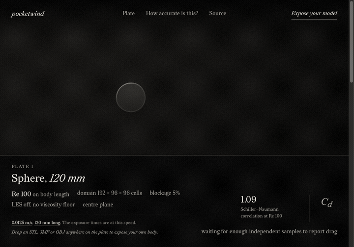

# pocketwind

Put the shape you're making in the wind.

Drop your 3D model into a browser wind tunnel and watch smoke trace the flow around it.

<picture>
  <source media="(prefers-reduced-motion: reduce)" srcset="docs/demo-still.png">
  
</picture>

**[Open the wind tunnel](https://pocketwind.intesarjawad.com/)**. You'll need a browser and GPU that support WebGPU; the validation page works without it.

Use it for a first look at the flow. The drag validation covers a sphere in one laminar-flow case, not an arbitrary design.

Or run it locally with Node.js 20 or newer:

```sh
git clone https://github.com/intesarjawad/pocketwind.git
cd pocketwind
npm ci
npm run dev
```

## What it is good for, and what it is not

**Validated:** drag on the laminar sphere at Re 100. On the default settings it lands within 10% of the reference at tiers M and L.

**Experimental:** vehicle bodies. The Ahmed body misses its reference at every tier on these browser grids, and those failing rows stay in the report. Use its drag and comparisons as flow visualisation, not as a vehicle drag prediction. [ADR 013](docs/adr/013-high-reynolds-walls.md) sets out the grid limits and the evidence still missing.

The default plate shows why. It is the Ahmed body in a 128 × 64 × 64 cell domain at Re 320 on its length, the solver's viscosity floor. The full-scale reference, 40 m/s on a 1044 mm body, would be Re 2.8 million. So the plate's 2.27 is the drag of a far more viscous flow than the 0.285 Ahmed and colleagues measured.

## How it works

The browser reads a mesh, voxelizes it locally and runs a lattice Boltzmann solver on your own GPU. Nothing is uploaded and no account is needed.

Every thread on the plate is a smoke streakline carried through the live velocity field: a rake upstream, and dye ports on the roof, base and nose edges whose dye winds into the vortex behind the base.

Results report their grid, sampling uncertainty and effective Reynolds number. A grid check measures tiers S, M and L at one Reynolds number, and its band applies to the finest grid. The panel keeps the common choices together and puts the solver and storage options under Advanced.

## Validation

`npm run validate` runs every case in a GPU browser and writes [the validation report](docs/validation.md): analytic checks, grid convergence, each case with its reference value and error, and the cases that fail or were skipped. The same results load on the app's validation page.

`npm run stills` develops the README image and the social card in a GPU browser and prints the caption it captured.

## Go deeper

- [Architecture](docs/architecture.md)
- [Numerical conventions, buffer contracts and sources](docs/numerics.md)
- [Add a body or a check of your own](docs/extend.md)
- [Browser support](docs/browser-support.md)
- [Decision records](docs/adr/)

To contribute, see [CONTRIBUTING.md](CONTRIBUTING.md). The code is under the [MIT License](LICENSE).
